# Сборник 2. Вариант 6. Анализатор зависимостей npm

**Студент:** Гейленко Ника  
**Группа:** ИКБО-42-25

## Цель работы

Разработать инструмент анализа графа зависимостей пакетов JavaScript (npm).
Выполняются только этапы 1–3. Первый этап реализован и проверен:
консольный прототип с конфигурацией JSON и обработкой ошибок.
Добавлен этап 2 — получение прямых зависимостей. Добавлен этап 3 — итеративный DFS, ограничение глубины и обработка циклов.
На первом этапе приложение не обращается к интернету и не получает зависимости.

## Подготовка и запуск

Нужен Python 3.11 или новее. Сторонние пакеты и сборка не требуются.
В VS Code открыть папку `npm_variant6`, затем **Terminal → New Terminal**.
Все команды ниже вводятся в терминале из папки проекта.
На компьютере, где выполнялась работа:

```powershell
cd "C:\Users\Honor\Documents\ChatGPT\nika\npm_variant6"
```

На другом компьютере следует указать свой путь. Это консольное приложение:
результаты появляются прямо в терминале, отдельное окно не открывается.
В Windows также можно запустить `run.bat`.

## Этап 1. Минимальный прототип с конфигурацией

### Шаг 1. Чтение корректных настроек

Настройки хранятся в [config.json](config.json):

```json
{
  "package": "express",
  "repository": "https://registry.npmjs.org",
  "test_mode": false,
  "ascii_tree": false,
  "max_depth": 3
}
```

| Параметр | Значение и назначение |
| --- | --- |
| `package` | Имя анализируемого пакета; здесь `express` |
| `repository` | URL реестра npm; в тестовом режиме — путь к файлу |
| `test_mode` | `false` — реальный реестр; `true` — тестовый файл |
| `ascii_tree` | Настройка вывода ASCII-дерева; сам вывод относится к этапу 5 и здесь не реализуется |
| `max_depth` | Максимальная глубина анализа, целое число не меньше 0; корень имеет глубину 0 |

Запуск:

```powershell
python src/main.py --config config.json --stage 1
```

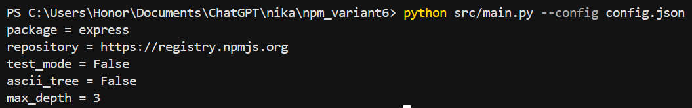

**Результат и объяснение:** программа прочитала JSON, проверила значения
и вывела все пять параметров в формате ключ-значение. `False` в выводе Python
соответствует `false` в JSON. Этот вывод — требование первого этапа;
анализ зависимостей пока не производится.

`--config` задаёт только путь к файлу; все пять пользовательских настроек
читаются из JSON. Без `--config` используется `config.json` в текущей папке.
Имя обычного пакета проверяется как имя npm, включая форму `@scope/name`.
В тестовом режиме допускаются имена из больших латинских букв.

### Шаг 2. Проверка отрицательной глубины

В `config.json` временно заменить значение на:

```json
"max_depth": -1
```

Сохранить файл и повторить команду запуска из шага 1.

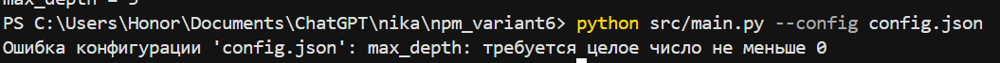

**Результат:** программа сообщает, что требуется целое число не меньше 0.
Отрицательная глубина отклоняется. После проверки вернуть `"max_depth": 3`.

### Шаг 3. Проверка пустого имени пакета

Временно заменить значение:

```json
"package": ""
```

Сохранить файл и повторить запуск.

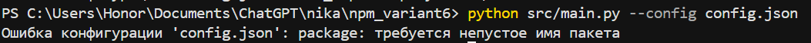

**Результат:** программа требует непустое имя пакета.
После проверки вернуть `"package": "express"`.

### Шаг 4. Проверка неверного URL

При `"test_mode": false` временно указать:

```json
"repository": "wrong-address"
```

Сохранить файл и повторить запуск.

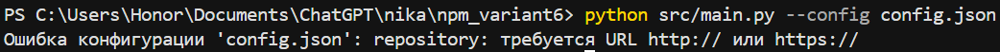

**Результат:** программа требует URL с `http://` или `https://` и адресом сервера.
Это проверка формата URL, а не доступности сервера в интернете.
После проверки вернуть `"repository": "https://registry.npmjs.org"`.

### Шаг 5. Проверка типа test_mode

Временно указать значение в кавычках:

```json
"test_mode": "false"
```

Сохранить файл и повторить запуск.

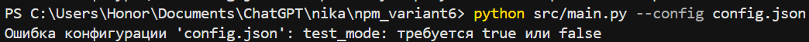

**Результат:** программа требует логическое значение `true` или `false`.
`"false"` в кавычках является строкой, поэтому оно отклоняется.
После проверки вернуть `"test_mode": false` без кавычек.

### Шаг 6. Проверка типа ascii_tree

Временно указать:

```json
"ascii_tree": "true"
```

Сохранить файл и повторить запуск.

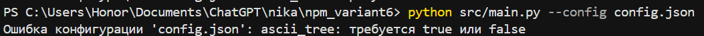

**Результат:** строка `"true"` не является логическим значением.
После проверки вернуть `"ascii_tree": false` без кавычек.
Таким образом, вручную продемонстрированы ошибки всех пяти параметров.

### Шаг 7. Настройки тестового режима

В [examples/test-config.json](examples/test-config.json) подготовлены
отдельные настройки:

```json
{
  "package": "A",
  "repository": "test-repository.json",
  "test_mode": true,
  "ascii_tree": false,
  "max_depth": 3
}
```

Запуск:

```powershell
python src/main.py --config examples/test-config.json --stage 1
```

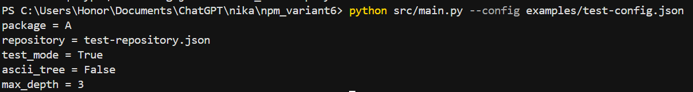

**Результат:** выбран пакет `A` и тестовый файл вместо URL, режим `test_mode`
включён. Программа проверяет существование файла, но на этапе 1 ещё не анализирует
его граф. Относительный путь `repository` считается от папки конфигурационного
файла, поэтому здесь используется `examples/test-repository.json`.
Этот файл содержит подготовленный пример графа для этапа 3.

### Шаг 8. Автоматические тесты

В терминале:

```powershell
python -m unittest discover -s tests -v
```

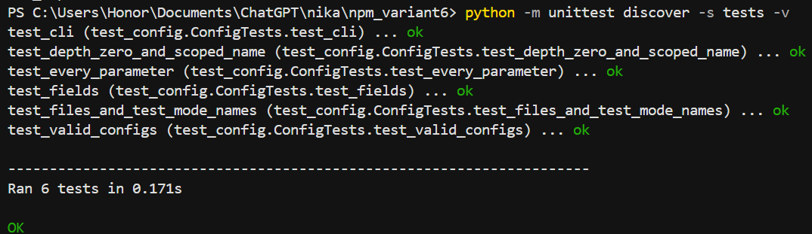

**Результат:** `Ran 6 tests`, итог `OK`. Проверены правильные конфигурации,
ошибочные значения каждого параметра, глубина 0, имя вида `@scope/name`,
состав полей, ошибки файлов, синтаксис JSON, повторяющиеся ключи,
правила тестового режима и запуск CLI с выводом пяти настроек.
Один тест может проверять несколько входных значений.

## Обработка ошибок

Ошибки конфигурации выводятся в терминал, приложение завершается с кодом 2.
Помимо проверок на скриншотах, программа обнаруживает отсутствующие и лишние
поля, повторяющиеся ключи, повреждённый JSON, отсутствие конфигурационного
файла и отсутствие файла тестового репозитория.

Проверка отсутствующего файла конфигурации:

```powershell
python src/main.py --config missing.json
```

После ручных проверок в основном `config.json` сохранены корректные значения
из шага 1. Не следует одновременно оставлять несколько ошибок:
программа сообщает первую обнаруженную причину.

## Связь с кодом

| Файл | Назначение |
| --- | --- |
| [src/main.py](src/main.py) | `main()` читает аргумент `--config`, вызывает загрузчик, выводит параметры и задаёт код завершения |
| [src/config.py](src/config.py) | `Settings` хранит настройки; `validate()` проверяет значения; `unique_keys()` запрещает повтор ключей; `load_settings()` читает JSON; `ConfigError` описывает ошибки |
| [tests/test_config.py](tests/test_config.py) | Шесть автоматических тестов с проверками разных входных данных |
| [examples/test-repository.json](examples/test-repository.json) | Пример графа тестового репозитория для будущего этапа 3 |
| [screenshots](screenshots) | Скриншоты фактических проверок первого этапа |

Последовательность работы: запуск `main.py` → чтение JSON в `load_settings()` →
проверка параметров в `validate()` → объект `Settings` → вывод ключ-значение.
При ошибке вместо вывода настроек показывается её причина.

## Итог первого этапа

Реализовано консольное приложение, читающее пользовательские параметры
из JSON. Продемонстрированы корректные настройки обычного и тестового режимов,
ошибки всех пяти параметров и успешное выполнение автоматических тестов.
Следующие этапы будут добавляться отдельными коммитами.

## Этап 2. Получение прямых зависимостей npm

В терминале VS Code из папки проекта:

```powershell
python src/main.py --config config.json
```

По умолчанию демонстрируется этап 2. Параметр `--stage 1` сохраняет возможность
показать только настройки первого этапа, `--stage 2` явно выбирает второй.
Пять пользовательских настроек по-прежнему читаются из JSON.

Программа отправляет HTTP GET по адресу `<repository>/<package>/latest`,
читает JSON и самостоятельно извлекает `dependencies` — прямые рабочие
зависимости выбранного пакета. Выводятся версия пакета, количество зависимостей,
их имена и заявленные диапазоны версий. Используются только стандартные модули
Python `urllib` и `json`. npm, pip и сторонние библиотеки для получения
зависимостей не вызываются. Поле `devDependencies` не анализируется.
Диапазоны версий печатаются без разрешения в конкретные версии.

Источник описания API: [официальная документация npm Registry API](https://github.com/npm/registry/blob/main/docs/REGISTRY-API.md).

`src/registry.py`: `get_dependencies()` получает JSON по HTTP;
`parse_metadata()` проверяет ответ и извлекает зависимости;
`RegistryError` описывает ошибки сети, HTTP и формата ответа.
Пакет без `dependencies` выводится с сообщением об отсутствии зависимостей.
HTTP 404, недоступность сети, таймаут и некорректный JSON обрабатываются
понятными сообщениями и кодом завершения 1. Нужен доступ в интернет.

Тестовый граф пока не используется: для этапа 2 нужно `test_mode: false`.
Глубина и настройка ASCII-дерева ещё не влияют на вывод прямых зависимостей.
Версия `latest` и список зависимостей могут меняться со временем.

`tests/test_registry.py` проверяет HTTP-запросы на подставных ответах,
кодирование scoped-имён, обработку метаданных, отсутствие зависимостей,
ошибки сети и неверный JSON. Всего после добавления этапа 2 — 12 тестов.

### Шаг 9. Получение прямых зависимостей express

В терминале VS Code:

```powershell
python src/main.py --config config.json
```

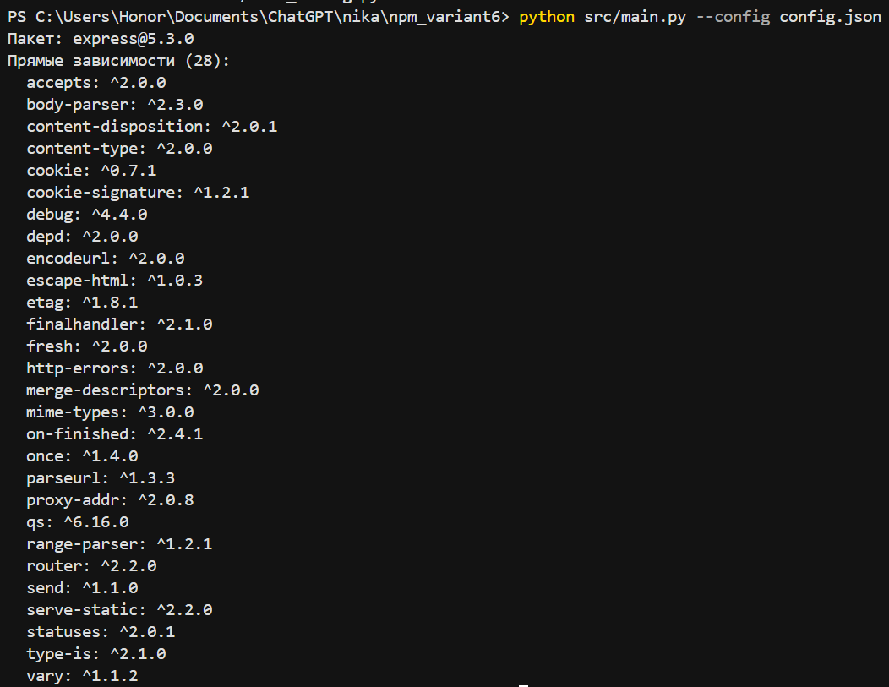

**Результат:** в момент проверки реестр вернул `express@5.3.0` и 28 прямых
зависимостей. Например, `accepts: ^2.0.0` означает зависимость от пакета
`accepts` с указанным диапазоном версий. Диапазон взят из метаданных,
конкретная версия зависимости на этом этапе не выбирается.
Программа не устанавливает пакеты — она только читает их описания.
На этапе 2 зависимости самих зависимостей ещё не запрашиваются.

### Шаг 10. Обработка отсутствующего пакета

В `config.json` временно указано:

```json
"package": "nika-ikbo42-nonexistent-package-987654321"
```

После сохранения повторён запуск:

```powershell
python src/main.py --config config.json
```

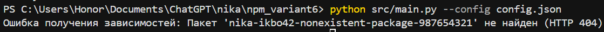

**Результат:** реестр вернул HTTP 404. Программа обработала его и вывела,
что пакет не найден, без необработанного исключения Python.
После проверки значение `package` возвращено к `express`.

### Шаг 11. Автоматические тесты этапов 1–2

```powershell
python -m unittest discover -s tests -v
```

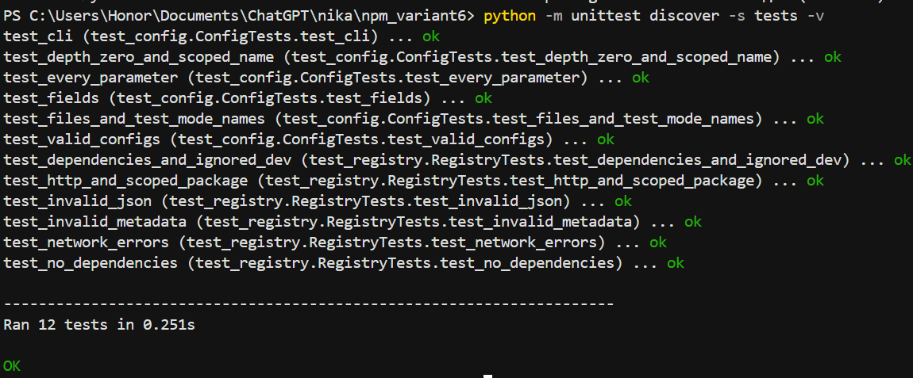

**Результат:** `Ran 12 tests`, итог `OK`. Шесть тестов первого этапа
продолжают проходить; ещё шесть проверяют получение и разбор метаданных,
пакет без зависимостей, scoped-имена и ошибки сети/формата ответа.
Для воспроизводимости HTTP-ответы в тестах подставляются через `unittest.mock`;
реальное обращение к npm отдельно показано в шаге 9.


## Этап 3. Граф зависимостей, DFS без рекурсии

Этап выбирается явно через `--stage 3`. Запуск без `--stage` по-прежнему
показывает прямые зависимости этапа 2. Все пять настроек берутся из JSON.

### Тестовый граф с общей зависимостью

```powershell
python src/main.py --stage 3 --config examples/test-config.json
```

В `test-repository.json`: A зависит от B и C; B и C зависят от D;
у D нет зависимостей. Порядок DFS: A, B, D, C. Общий пакет D не дублируется,
при этом сохраняются оба ребра B → D и C → D.

### Максимальная глубина

```powershell
python src/main.py --stage 3 --config examples/depth1-config.json
python src/main.py --stage 3 --config examples/depth0-config.json
```

При глубине 1 включены A, B и C; зависимости B и C не запрашиваются.
При глубине 0 включён только A. Корень имеет глубину 0.
Для каждого узла показывается минимальное расстояние от корня.
Если DFS сначала дошёл по длинному пути, а затем нашёл короткий,
узел расширяется повторно с учётом оставшегося лимита глубины.

### Циклические зависимости

```powershell
python src/main.py --stage 3 --config examples/cycle-config.json
```

Цикл A → B → C → A выводится отдельно, программа завершается нормально.
Обход хранит уже достигнутые глубины и не следует по циклу бесконечно.
Циклы ищутся итеративным DFS с цветами и активным путём в исследованных рёбрах.
Циклы за границей заданной глубины могут не попасть в построенный граф.
Вывод показывает найденные свидетельства циклов, а не перечисляет все
возможные простые циклы в сложном графе.

### Пакет без зависимостей и неверный тестовый граф

```powershell
python src/main.py --stage 3 --config examples/isolated-config.json
python src/main.py --stage 3 --config examples/bad-graph-config.json
```

Первый пример содержит только A. Во втором A ссылается на отсутствующий B:
программа сообщает ошибку структуры тестового репозитория.
Формат тестового файла — JSON-объект: имя пакета из больших латинских букв
соответствует списку имён зависимостей. Все имена зависимостей должны быть
объявлены ключами. Повторы ключей и рёбер запрещены.

### Работа с реестром npm

```powershell
python src/main.py --stage 3 --config examples/npm-depth1-config.json
```

Это граф express с глубиной 1. Для более глубокого обхода можно увеличить
`max_depth` в отдельной конфигурации. Для каждого раскрываемого имени берутся
метаданные `latest`, ответы кэшируются в пределах запуска.
Это граф зависимостей по именам пакетов: разные версии одного имени
не представлены отдельными узлами, диапазоны SemVer не разрешаются.
Он не является точной моделью дерева установленного npm-проекта.
Ошибки сети останавливают построение с понятным сообщением.

### Реализация и тесты

`src/graph.py`: `build_graph()` строит граф с помощью списка-стека;
`find_cycles()` обнаруживает циклы также без рекурсии;
`load_test_graph()` читает и проверяет тестовый JSON;
`analyze()` выбирает источник данных; `GraphResult` хранит результат;
`print_graph()` выводит связи и глубины. Вывод списка связей не является
ASCII-деревом или визуализацией этапа 5; `ascii_tree` пока не используется.
Обратные зависимости этапа 4 и визуализация этапа 5 не реализованы.

После добавления этапа 3 выполняется 21 автоматический тест:

```powershell
python -m unittest discover -s tests -v
```

Проверяются общие зависимости, глубина 0 и 1, обычный цикл, петля,
более короткий путь к ранее посещённому узлу, цепочка из 1501 узла
без рекурсии, повреждённые графы, кэш HTTP-провайдера и запуск CLI.

### Результаты ручной проверки этапа 3

Все следующие команды выполнялись в терминале VS Code из папки проекта.

**1. Тестовый граф с общей зависимостью:**

```powershell
python src/main.py --stage 3 --config examples/test-config.json
```

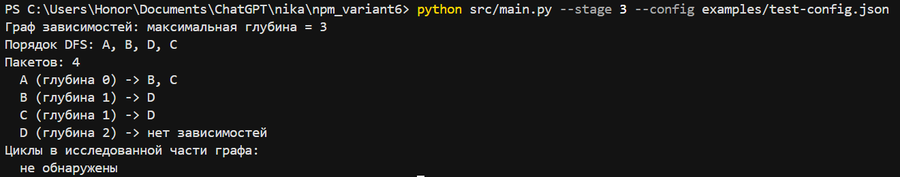

Программа нашла 4 пакета. DFS проходит вглубь: A → B → D, затем возвращается
к C. Результирующий порядок — A, B, D, C. Пакет D общий для B и C:
обе связи сохранены, сам узел учитывается один раз. Циклы не обнаружены.

**2. Ограничение глубины одним уровнем:**

```powershell
python src/main.py --stage 3 --config examples/depth1-config.json
```

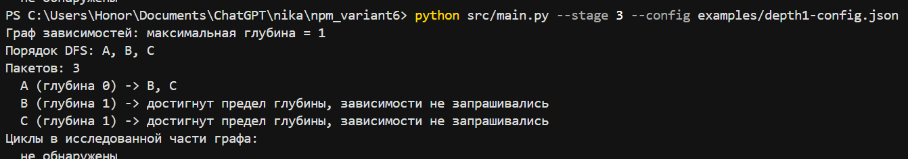

В граф включены A (глубина 0), B и C (глубина 1). Зависимости узлов на
предельной глубине не запрашиваются, поэтому D на глубине 2 не включён.
Фраза о пределе глубины не означает, что у узла нет зависимостей:
они просто не исследованы в этом запуске.

**3. Циклическая зависимость:**

```powershell
python src/main.py --stage 3 --config examples/cycle-config.json
```

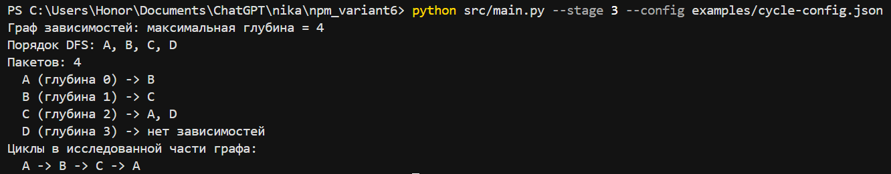

Выведен цикл A → B → C → A. Повторная ссылка на A не вызывает бесконечный
обход. Программа также исследовала зависимость D и завершила работу.

**4. Пакет без зависимостей:**

```powershell
python src/main.py --stage 3 --config examples/isolated-config.json
```

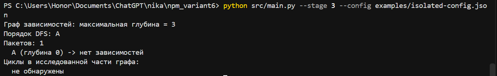

Результат содержит только A на глубине 0, без зависимостей и циклов.

**5. Некорректный тестовый репозиторий:**

```powershell
python src/main.py --stage 3 --config examples/bad-graph-config.json
```

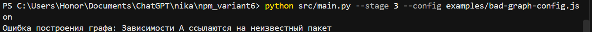

A ссылается на B, который не объявлен в JSON. Программа сообщает ошибку
структуры графа и завершает работу с кодом 1.

**6. Все автоматические тесты:**

```powershell
python -m unittest discover -s tests -v
```

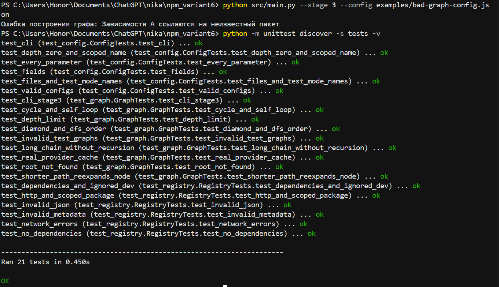

Результат: `Ran 21 tests`, итог `OK`. Ошибка в предыдущем запуске в верхней
части скриншота относится к намеренно неверному тестовому графу;
все автоматические тесты ниже прошли успешно.

## Сохранение этапов

Первый этап сохранён коммитом `50fadba`
(`feat: implement stage 1 JSON configuration`).
Второй этап сохранён коммитом `e77b739`
(`feat: add stage 2 npm direct dependencies`).
Третий этап подготовлен для отдельного коммита
`feat: add stage 3 iterative dependency graph analysis`.

## Результат работы

Реализованы первые три этапа: JSON-конфигурация с проверками,
получение прямых зависимостей npm без менеджеров пакетов и сторонних библиотек,
построение графа итеративным DFS с ограничением глубины, обработкой циклов
и тестовым режимом. Обратные зависимости и визуализация этапов 4–5
в выбранный объём работы не входят.

