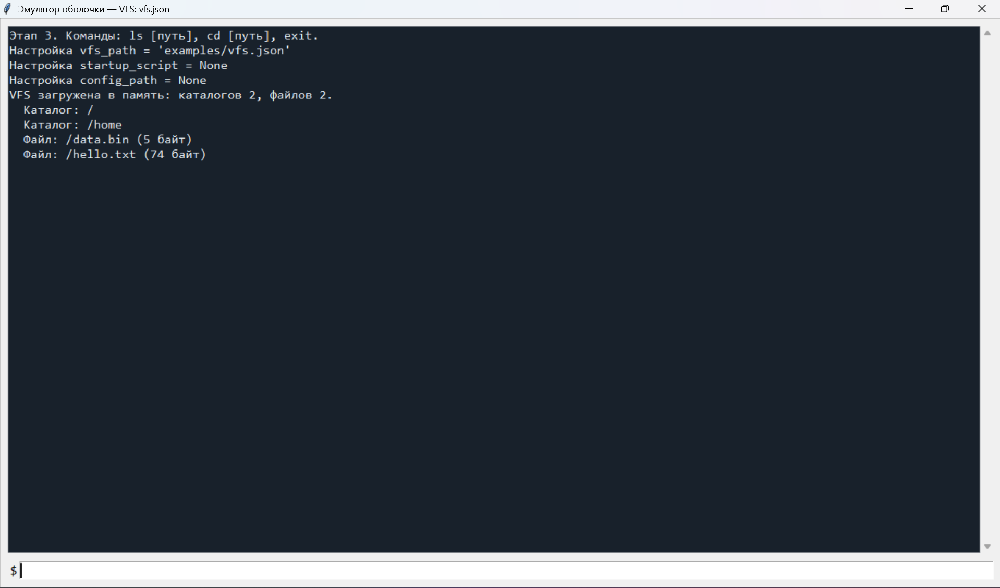
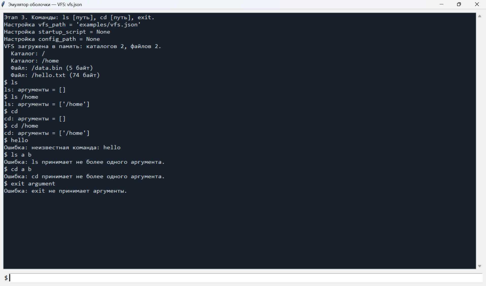
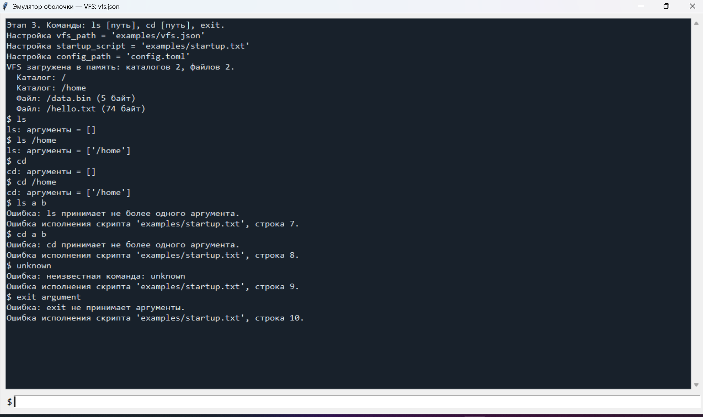
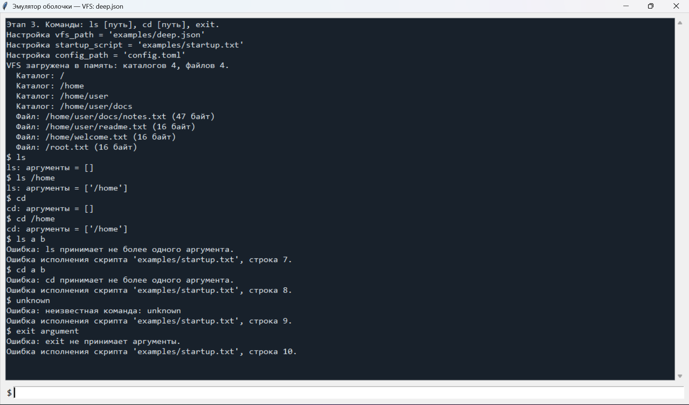
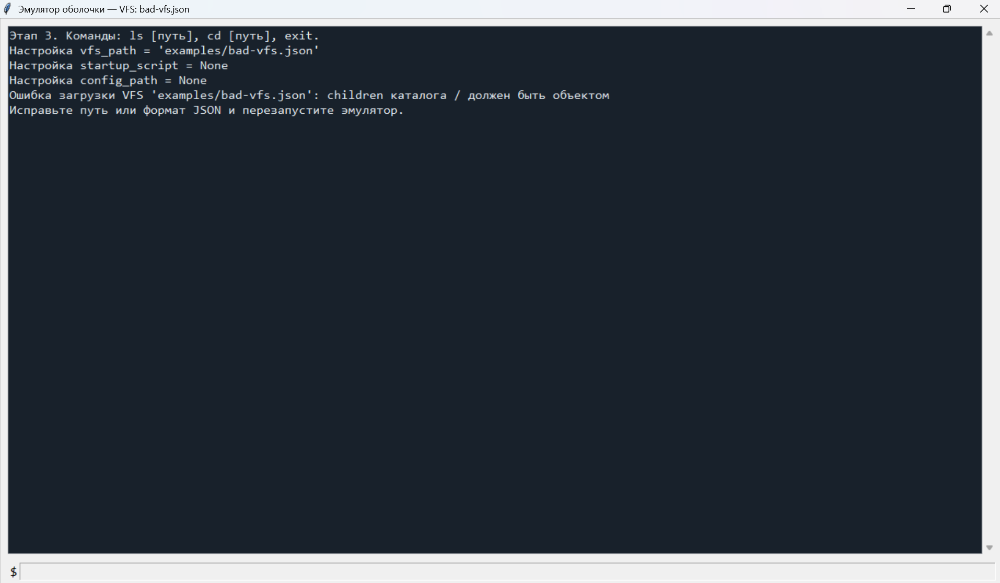
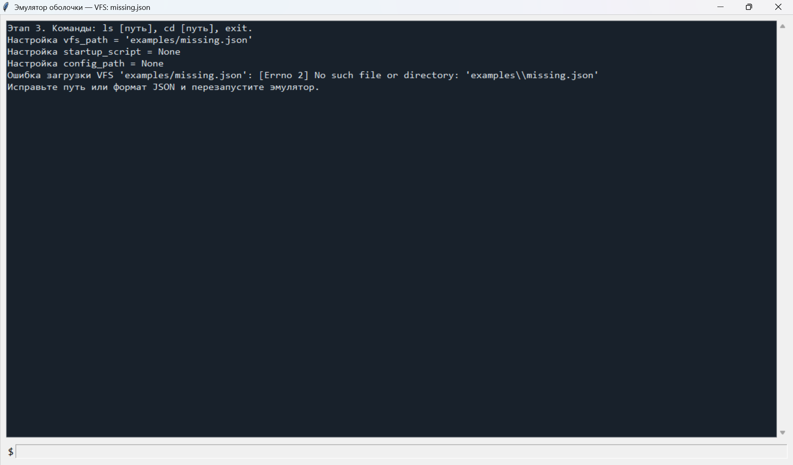
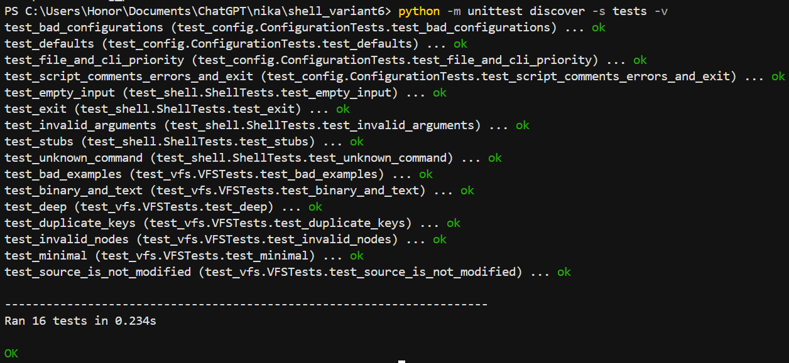

# Эмулятор оболочки ОС — вариант 6, этапы 1–3

**Студент:** Гейленко Ника  
**Группа:** ИКБО-42-25

## Цель и среда выполнения

Разработать эмулятор командной оболочки UNIX-подобной ОС. Выполнены три этапа: REPL, конфигурация и загрузка виртуальной файловой системы. Использованы Python и Tkinter, запуск выполнялся в Windows из терминала VS Code.

REPL — цикл «прочитать команду → обработать → показать результат → ждать следующего ввода». VFS — виртуальные файлы и папки, описанные в JSON и хранящиеся после загрузки в памяти программы.

На скриншотах используется итоговая версия со всеми тремя этапами, поэтому в окне написано «Этап 3». Функциональность этапов проверяется последовательно. `ls` и `cd` остаются заглушками по требованиям этапов 1–3. Их полноценная реализация относится к этапу 4, который не входит в эту работу.

## Подготовка

Нужен Python 3.11 или новее с Tkinter. Сторонние пакеты не требуются. Сборка не нужна: Python выполняет исходные файлы напрямую.

В VS Code открыть папку `shell_variant6` через **File → Open Folder**, затем **Terminal → New Terminal**. На компьютере, где выполнялась работа, переход в папку:

```powershell
cd "C:\Users\Honor\Documents\ChatGPT\nika\shell_variant6"
```

На другом компьютере нужно указать свой путь. Все следующие команды запуска выполняются из папки `shell_variant6`.

| Где вводить | Что вводить |
| --- | --- |
| Терминал VS Code | `python ...`, команды тестирования и запуска сценариев |
| Нижняя строка окна эмулятора | `ls`, `cd`, `exit` |

Перед следующим запуском закрыть предыдущее окно эмулятора. Пока оно открыто, запустивший его терминал занят.

## Этап 1. REPL

### Шаг 1. Запуск и графическое окно

**В терминале VS Code:**

```powershell
python src/main.py
```

Открывается окно с историей команд и полем ввода внизу. Заголовок содержит имя VFS: `vfs.json`.



**Объяснение:** окно создано библиотекой Tkinter. Программа готова принимать команды. В итоговой версии также показаны настройки и результат загрузки VFS. Без параметров выбран `examples/vfs.json`; `None` означает, что конфигурационный файл и стартовый скрипт не заданы.

### Шаг 2. Команды-заглушки и ошибки

**В нижней строке эмулятора** вводились по одной команде с нажатием Enter:

```text
ls
ls /home
cd
cd /home
hello
ls a b
cd a b
exit argument
```



**Объяснение:** `ls` и `cd` выводят своё имя и аргументы. `[]` — аргументов нет, `['/home']` — один аргумент пути. `hello` не распознаётся. `ls a b` и `cd a b` содержат лишние аргументы: в этой реализации разрешён максимум один путь. `exit argument` также вызывает ошибку: команда выхода не принимает аргументы. После ошибок приложение продолжает работать.

В [src/shell.py](src/shell.py) функция `execute()` использует `split()`: строка `cd /home` превращается в список `["cd", "/home"]`. Первое слово — команда, остальные — аргументы. Повторные пробелы игнорируются. Пустая строка не выполняет команду. Кавычки, пути с пробелами, флаги и конвейеры не поддерживаются.

Дополнительная ручная проверка: нажать Enter на пустой строке и ввести `  ls   /home  `.

### Шаг 3. Завершение программы

**В эмуляторе:**

```text
exit
```

Окно закрывается и терминал VS Code снова принимает команды. Закрытие проверяется непосредственно, без отдельного скриншота. В `shell.py` устанавливается `should_exit=True`, после чего `main.py` закрывает окно методом `destroy()`.

## Этап 2. Конфигурация

### Шаг 4. Настройки TOML и стартовый скрипт

[config.toml](config.toml) — текстовый файл настроек:

```toml
vfs_path = "examples/vfs.json"
startup_script = "examples/startup.txt"
```

Первая строка указывает, откуда загрузить VFS. Вторая — откуда прочитать команды для автоматического выполнения. Эти строки записываются в файл, а не вводятся в терминал.

**В терминале VS Code:**

```powershell
python src/main.py --config config.toml
```

Это означает: запустить программу с настройками из `config.toml`.



**Объяснение:** программа показала итоговые параметры и выполнила команды из [examples/startup.txt](examples/startup.txt). Видны и ввод после `$`, и ответы. Комментарии начинаются с `#` и пропускаются, как и пустые строки. Неверные команды специально включены в скрипт: показаны ошибки с номерами строк. После ошибки команды выполнение продолжается.

### Шаг 5. Приоритет параметров запуска

После закрытия окна **в терминале VS Code:**

```powershell
python src/main.py --config config.toml --vfs examples/deep.json
```



**Объяснение:** в TOML указано `examples/vfs.json`, но параметр `--vfs` заменяет его на `examples/deep.json`. Выбранный файл виден в настройках и заголовке. Путь к стартовому скрипту остался из TOML. Значения командной строки имеют приоритет над конфигурационным файлом.

### Поддержанные параметры

| Параметр | Назначение |
| --- | --- |
| `--config` | Путь к TOML-файлу |
| `--vfs` | Путь к JSON VFS; переопределяет `vfs_path` из TOML |
| `--startup` | Путь к стартовому скрипту; переопределяет `startup_script` из TOML |

TOML читается только при явном указании `--config`. Относительные пути считаются от текущей рабочей папки терминала. Итоговые настройки выводятся в терминал и окно.

Пример явного указания стартового скрипта:

```powershell
python src/main.py --vfs examples/vfs.json --startup examples/stage3.txt
```

Дополнительные проверки без отдельных скриншотов:

```powershell
python src/main.py --config examples/missing.toml
python src/main.py --config examples/bad-config.toml
python src/main.py --startup examples/missing.txt
python src/main.py --startup examples/exit.txt
```

Первые две команды показывают в терминале ошибки отсутствующего или некорректного TOML и завершаются с кодом 2. Третья показывает ошибку чтения стартового скрипта в окне; ручной ввод остаётся доступным. Четвёртая выполняет `ls` и `exit` из файла и закрывает окно.

## Этап 3. Виртуальная файловая система

### Шаг 6. Загрузка VFS в память

На скриншоте шага 1 файл [examples/vfs.json](examples/vfs.json) дал 2 каталога, включая корень `/`, и 2 файла — текстовый и двоичный. На скриншоте шага 5 файл [examples/deep.json](examples/deep.json) дал 4 каталога и 4 файла. Путь `/home/user/docs/notes.txt` показывает вложенность до четвёртого уровня от корня.

**Объяснение:** JSON — текстовый формат записи структуры данных. Каталог содержит `type: "directory"` и объект `children` с дочерними узлами. Файл содержит `type: "file"`, кодировку `encoding` и содержимое `content`.

Пример двоичного файла из `vfs.json`:

```json
"data.bin": {
  "type": "file",
  "encoding": "base64",
  "content": "AAECA/8="
}
```

Base64 представляет двоичные данные текстом для хранения в JSON; после декодирования этого примера получается 5 байт. Текстовые файлы используют `encoding: "utf-8"`.

Загрузчик создаёт модель в памяти: пути каталогов хранятся в множестве `set`, файлы — в словаре `dict` (виртуальный путь → байты содержимого). Исходный JSON открывается только для чтения. Виртуальные файлы не создаются на реальном диске, источник не меняется.

Список путей при запуске — отладочный вывод загрузчика. Команды `ls` и `cd` всё ещё заглушки и не обращаются к модели: например, `cd /missing` просто выводит полученный аргумент.

Минимальная VFS проверяется отдельной командой:

```powershell
python src/main.py --vfs examples/minimal.json
```

Она содержит только корень: ожидается 1 каталог и 0 файлов. Эта структура также проверяется автоматическим тестом.

### Шаг 7. Неверная структура VFS

**В терминале VS Code:**

```powershell
python src/main.py --vfs examples/bad-vfs.json
```



**Объяснение:** файл существует, но `children` содержит список вместо объекта дочерних узлов. Программа сообщает причину ошибки. Ввод отключается, стартовый скрипт не запускается. Окно закрывается крестиком — ввести `exit` здесь нельзя.

### Шаг 8. Отсутствующий файл

**В терминале VS Code:**

```powershell
python src/main.py --vfs examples/missing.json
```



**Объяснение:** файла нет. Сообщение `No such file or directory` означает «файл или каталог не найден». Ввод отключён; после просмотра ошибки окно нужно закрыть крестиком.

Загрузчик также проверяет синтаксис JSON, повторяющиеся ключи, типы узлов, кодировки и корректность base64. Для каталога разрешены поля `type`, `children`; для файла — `type`, `encoding`, `content`. Имена не могут быть пустыми, равняться `.` или `..`, содержать `/`, `\` или управляющие символы.

## Шаг 9. Автоматические тесты

Закрыть эмулятор. **В терминале VS Code:**

```powershell
python -m unittest discover -s tests -v
```



**Результат:** выполнено 16 тестов, итог `OK`. Проверены команды, неверные аргументы, выход, пустой ввод, настройки и их приоритет, ошибки конфигурации, комментарии и ошибки стартового скрипта, минимальная и вложенная VFS, текст и двоичные данные. Отдельный тест проверяет, что изменение модели в памяти не меняет исходный JSON и не создаёт виртуальные файлы на диске.

## Демонстрационные сценарии Windows

| Файл | Назначение |
| --- | --- |
| [scripts/check_parameters.bat](scripts/check_parameters.bat) | Параметры запуска и приоритет |
| [scripts/check_errors.bat](scripts/check_errors.bat) | Ошибки настроек и стартового скрипта |
| [scripts/check_vfs.bat](scripts/check_vfs.bat) | Минимальная, обычная и вложенная VFS |
| [scripts/check_vfs_errors.bat](scripts/check_vfs_errors.bat) | Разные VFS и ошибки загрузки |

Пример запуска из PowerShell:

```powershell
.\scripts\check_vfs.bat
```

Сценарии последовательно открывают окна: для перехода к следующему примеру нужно закрыть текущее. [examples/stage3.txt](examples/stage3.txt) демонстрирует все поддержанные команды, виртуальные пути и ошибки. [examples/exit.txt](examples/exit.txt) демонстрирует выход из скрипта. `run.bat` запускает интерактивный режим без параметров.

## Связь с исходным кодом

| Файл | Что реализовано |
| --- | --- |
| [src/main.py](src/main.py) | `main()` запускает приложение; `ShellWindow` создаёт окно; `submit()` принимает ввод; `write()` показывает текст |
| [src/shell.py](src/shell.py) | `execute()` разбирает команды; `CommandResult` хранит ответ и признак завершения |
| [src/config.py](src/config.py) | `load_settings()` читает TOML и параметры запуска; `Settings` хранит настройки |
| [src/startup.py](src/startup.py) | `run_startup()` читает и выполняет скрипт, пропускает комментарии |
| [src/vfs.py](src/vfs.py) | `load_vfs()` загружает JSON; `read_node()` обходит дерево; `decode_file()` декодирует данные; `unique_object()` проверяет ключи; `VirtualFileSystem` хранит модель; `VFSError` описывает ошибки |
| [tests](tests) | Автоматические проверки |
| [screenshots](screenshots) | Скриншоты фактических запусков |

Обработка команды: Enter в окне → `submit()` в `main.py` → `execute()` в `shell.py` → результат → вывод в окно.

## История этапов

| Этап | Коммит | Сообщение |
| --- | --- | --- |
| 1. REPL | `3738e7f` | `feat: implement stage 1 GUI shell prototype` |
| 2. Конфигурация | `79fbf29` | `feat: add stage 2 configuration and startup scripts` |
| 3. VFS | `fcaced6` | `feat: add stage 3 in-memory JSON VFS` |

## Вывод

Выполнены первые три этапа варианта 6. Создан графический интерфейс, реализован разбор команд и обработка ошибок, добавлены настройки TOML, параметры запуска и стартовые скрипты. VFS загружается из JSON в память и поддерживает вложенные каталоги, текст и двоичные данные. Работа проверена интерактивно и автоматическими тестами.
